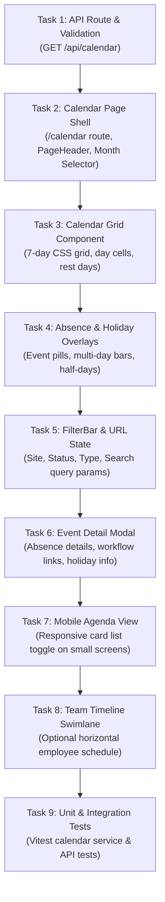

# Architecture Review & Implementation Plan: Absence Calendar Module

> **Date:** October 15, 2026  
> **Target System:** Leave & Absence Management System (Morocco - Loi 65-99)  
> **Status:** Real Absence & Public Holiday Event Rendering Implemented — Verified Clean Build & 119 Tests Passing

---

## 1. Specification Context & Ground Truth Verification

This document establishes the architecture review, event data mapping, and step-by-step implementation plan for the **Monthly Absence Calendar** feature within the existing Leave & Absence Management System.

### 1.1 Specification File Status
- A comprehensive workspace search for `ABSENCE_CALENDAR_SPEC.md` confirmed that **the file does not exist on disk** in the repository or user directory.
- Consistent with previous modules (e.g., `LEAVE_BALANCES_IMPLEMENTATION.md`), all requirements in this plan are derived directly from the explicit requirements set forth in the prompt, verified against the existing domain models, calculators, and API contracts. No requirements or database contracts have been invented.

### 1.2 Core Architectural Finding: Pre-existing Monthly Calendar Engine
The codebase **already contains** a dedicated, fully implemented Monthly Calendar domain calculation engine and application service:
1. **Domain Engine Algorithm 8:** [`src/domain/calculations/monthly-calendar.calculator.ts`](file:///c:/Users/DailWorkStation/Desktop/absnace/src/domain/calculations/monthly-calendar.calculator.ts) — Implements `MonthlyCalendarCalculator.generate(input: MonthlyCalendarInput): MonthlyCalendarOutput`.
2. **Facade Export:** [`src/domain/engine/leave-calculation.engine.ts`](file:///c:/Users/DailWorkStation/Desktop/absnace/src/domain/engine/leave-calculation.engine.ts#L159-L163) — Exposes `LeaveCalculationEngine.generateMonthlyCalendar()`.
3. **Application Service:** [`src/application/services/monthly-calendar.service.ts`](file:///c:/Users/DailWorkStation/Desktop/absnace/src/application/services/monthly-calendar.service.ts) — Implements `MonthlyCalendarService.getMonthlyCalendar(query: GetMonthlyCalendarQuery)`.
4. **Current Gaps Identified:**
   - **No API Route Handler:** There is currently no `/api/calendar` endpoint exposing `MonthlyCalendarService` to the frontend.
   - **No Frontend Route:** The sidebar in [`src/components/layout/Sidebar.tsx`](file:///c:/Users/DailWorkStation/Desktop/absnace/src/components/layout/Sidebar.tsx#L56) already points to `/calendar` (`{ title: "Calendrier mensuel", href: "/calendar", icon: CalendarRange }`), but `src/app/calendar/page.tsx` does not exist yet.
   - **No Client API Wrapper:** `src/lib/api/` does not yet contain a typed `calendar-client.ts`.
   - **Session Scoping in Service:** `MonthlyCalendarService` currently accepts `{ siteId, year, month, employeeId }` but does not yet integrate with `AuthGuard` or `AuthSession` for RBAC scoping.

---

## 2. Technology Stack & Framework Conventions

| Layer | Technology | Version | Key Notes & Architectural Constraints |
| :--- | :--- | :--- | :--- |
| **Framework** | Next.js (App Router) | `16.4.0` | Uses React Server Components, Route Handlers, Turbopack, and Partial Prerendering. |
| **UI Library** | React | `19.3.0` | Client components must declare `"use client"`. Avoid synchronous state updates in effects. |
| **Styling** | Tailwind CSS | `v4.0.0` | CSS variables, `@theme`, `@tailwindcss/turbopack`, dark mode classes (`dark:`), CSS Grid and Flexbox layouts. |
| **Icons** | Lucide React | `^1.56.0` | Enterprise icons (`CalendarRange`, `CalendarDays`, `Sparkles`, `Clock`, `ChevronLeft`, `ChevronRight`, `Filter`, `Layers`, `Eye`, `User`). |
| **Database & ORM** | Prisma Client with PostgreSQL | `^7.10.0` | PostgreSQL adapter (`@prisma/adapter-pg`, `pg`). Client output at `@/src/generated/prisma`. |
| **Validation** | Zod | `^4.6.7` | Used for query schemas, request validation, and form parsing. |
| **Serialization** | Custom Serializer | `src/server/serializers/response.serializer.ts` | Required for all JSON route responses to serialize Prisma `BigInt` (to `string`) and `Decimal` (to `number`). |
| **Testing** | Vitest & Playwright | Vitest `5.0.4`, Playwright `1.64.0` | 107 existing unit and integration tests passing (`vitest run`). |

### 2.1 Installed Calendar-Related Dependencies
A strict inspection of `package.json` confirms:
- **No external calendar libraries** (such as FullCalendar, React-Big-Calendar, Dayzed, react-calendar, etc.) are installed.
- **No external date libraries** (such as date-fns, dayjs, moment, or luxon) are installed.
- **Architectural Directive:** The Absence Calendar will be implemented cleanly using native JavaScript `Date` APIs, modern CSS Grid (7-column layout), and the pre-existing Tailwind CSS v4 styling primitives, avoiding any new third-party dependencies.

---

## 3. Relevant Files and Responsibilities Matrix

### 3.1 Domain & Business Engine Layer (`src/domain/`)

| File Path | Responsibilities | Key Functions / Types |
| :--- | :--- | :--- |
| [`src/domain/calculations/monthly-calendar.calculator.ts`](file:///c:/Users/DailWorkStation/Desktop/absnace/src/domain/calculations/monthly-calendar.calculator.ts) | Authoritative algorithm generating day-by-day cell matrix with working day vs. rest day vs. holiday classification, absence overlays, credit earnings, and site capacity summary. | `MonthlyCalendarCalculator.generate()`, `MonthlyCalendarOutput`, `CalendarDayCell`, `CalendarAbsenceItem`, `CalendarPublicHolidayItem` |
| [`src/domain/engine/leave-calculation.engine.ts`](file:///c:/Users/DailWorkStation/Desktop/absnace/src/domain/engine/leave-calculation.engine.ts) | Unified static facade exposing all Moroccan Labor Code calculation algorithms. | `LeaveCalculationEngine.generateMonthlyCalendar()` |
| [`src/domain/calculations/working-days.calculator.ts`](file:///c:/Users/DailWorkStation/Desktop/absnace/src/domain/calculations/working-days.calculator.ts) | Net working days calculation with statutory exclusions (weekly rest days, public holidays). | `WorkingDaysCalculator.calculate()` |
| [`src/domain/constants/moroccan-labor-rules.ts`](file:///c:/Users/DailWorkStation/Desktop/absnace/src/domain/constants/moroccan-labor-rules.ts) | Moroccan labor constants (Loi n° 65-99). | `MOROCCAN_LABOR_RULES` |

### 3.2 Application Services & Modules (`src/application/` & `src/modules/`)

| File Path | Responsibilities | Key Functions / Exports |
| :--- | :--- | :--- |
| [`src/application/services/monthly-calendar.service.ts`](file:///c:/Users/DailWorkStation/Desktop/absnace/src/application/services/monthly-calendar.service.ts) | Queries Prisma for site schedule, active staff count, public holidays in month, overlapping absences (`APPROVED`, `PENDING`), and holiday credits, then executes `MonthlyCalendarCalculator`. | `MonthlyCalendarService.getMonthlyCalendar(query: GetMonthlyCalendarQuery)` |
| [`src/modules/absences/absence.service.ts`](file:///c:/Users/DailWorkStation/Desktop/absnace/src/modules/absences/absence.service.ts) | Absence request lifecycle, approval workflow, and paginated query with overlapping date filters. | `AbsenceService.listAbsences()`, `AbsenceService.getAbsenceById()` |
| [`src/modules/absences/absence.schema.ts`](file:///c:/Users/DailWorkStation/Desktop/absnace/src/modules/absences/absence.schema.ts) | Zod schemas for absence queries (`startDate`, `endDate`, `status`, `typeId`, `siteId`). | `AbsenceQuerySchema`, `CreateAbsenceSchema` |
| [`src/modules/public-holidays/public-holiday.service.ts`](file:///c:/Users/DailWorkStation/Desktop/absnace/src/modules/public-holidays/public-holiday.service.ts) | Public holiday listing, creation, and detail queries. | `PublicHolidayService.listHolidays()`, `PublicHolidayService.getHolidayById()` |
| [`src/modules/sites/site.service.ts`](file:///c:/Users/DailWorkStation/Desktop/absnace/src/modules/sites/site.service.ts) | Site catalog with weekly rest days (`weeklyRestDays: [0]`) and timezone. | `SiteService.listSites()`, `SiteService.getSiteById()` |
| [`src/modules/auth/auth.guard.ts`](file:///c:/Users/DailWorkStation/Desktop/absnace/src/modules/auth/auth.guard.ts) | RBAC authorization checks (`ADMIN`, `HR_MANAGER`, `SUPERVISOR`, `EMPLOYEE`). | `AuthGuard.requireRole()`, `AuthGuard.requireAccessEmployee()` |
| [`src/modules/auth/session.resolver.ts`](file:///c:/Users/DailWorkStation/Desktop/absnace/src/modules/auth/session.resolver.ts) | Resolves user identity from cookie, authorization header, or `x-user-id`. | `SessionResolver.resolve()`, `SessionResolver.require()` |

### 3.3 API Handlers & Client Libraries (`src/app/api/` & `src/lib/api/`)

| File Path | Description & Current State |
| :--- | :--- |
| [`src/app/api/absences/route.ts`](file:///c:/Users/DailWorkStation/Desktop/absnace/src/app/api/absences/route.ts) | Existing REST endpoint for listing absences with date-range, employee, site, type, and status filtering. |
| [`src/app/api/public-holidays/route.ts`](file:///c:/Users/DailWorkStation/Desktop/absnace/src/app/api/public-holidays/route.ts) | Existing REST endpoint for public holidays (year, date range, search). |
| [`src/app/api/calendar/route.ts`](file:///c:/Users/DailWorkStation/Desktop/absnace/src/app/api/calendar/route.ts) | **Missing route:** Needs to be created to expose `MonthlyCalendarService` with session validation and RBAC scoping. |
| [`src/lib/api/absence-client.ts`](file:///c:/Users/DailWorkStation/Desktop/absnace/src/lib/api/absence-client.ts) | Client library for absences (`listAbsences`, `getAbsenceTypes`). |
| [`src/lib/api/holiday-client.ts`](file:///c:/Users/DailWorkStation/Desktop/absnace/src/lib/api/holiday-client.ts) | Client library for public holidays (`listHolidays`, `getHolidayById`). |
| [`src/lib/api/calendar-client.ts`](file:///c:/Users/DailWorkStation/Desktop/absnace/src/lib/api/calendar-client.ts) | **Missing client:** Needs to be created to wrap `GET /api/calendar`. |

### 3.4 Navigation & Layout Shell (`src/app/` & `src/components/layout/`)

| File Path | Description & Current State |
| :--- | :--- |
| [`src/components/layout/Sidebar.tsx`](file:///c:/Users/DailWorkStation/Desktop/absnace/src/components/layout/Sidebar.tsx#L56) | Already includes navigation entry `{ title: "Calendrier mensuel", href: "/calendar", icon: CalendarRange }` under "GESTION RH & ADMIN". |
| [`src/app/calendar/page.tsx`](file:///c:/Users/DailWorkStation/Desktop/absnace/src/app/calendar/page.tsx) | **Implemented & Active:** Calendar route featuring PageHeader, month/year navigation toolbar, quick date jumpers, and responsive 7-column calendar grid. |
| [`src/components/calendar/CalendarGrid.tsx`](file:///c:/Users/DailWorkStation/Desktop/absnace/src/components/calendar/CalendarGrid.tsx) | **Implemented & Active:** 7-column grid layout (Monday-Sunday), weekday headers, today highlights, and muted adjacent month padding. |
| [`src/lib/calendar/calendar-grid.ts`](file:///c:/Users/DailWorkStation/Desktop/absnace/src/lib/calendar/calendar-grid.ts) | **Implemented & Active:** Pure timezone-safe month grid builder, adjacent month calculator, and date key utilities. |
| [`src/components/layout/AppLayout.tsx`](file:///c:/Users/DailWorkStation/Desktop/absnace/src/components/layout/AppLayout.tsx) | Application shell providing collapsible desktop sidebar and mobile navigation drawer. |
| [`src/components/layout/PageContainer.tsx`](file:///c:/Users/DailWorkStation/Desktop/absnace/src/components/layout/PageContainer.tsx) | Responsive container wrapper (`max-w-7xl` or `fluid`). |

---

## 4. Reusable UI Components Catalog

The application has a robust, mature component library built with Tailwind CSS v4 and Lucide React. **These components will be reused directly without introducing redundant components:**

| Category | Component & File | Usage in Calendar Module |
| :--- | :--- | :--- |
| **Page Layout** | [`PageHeader`](file:///c:/Users/DailWorkStation/Desktop/absnace/src/components/shared/PageHeader.tsx) | Calendar title ("Calendrier Mensuel des Absences"), month/year title, breadcrumbs, action buttons (Month navigation, Today button, Export). |
| **KPI Cards** | [`StatCard`](file:///c:/Users/DailWorkStation/Desktop/absnace/src/components/shared/StatCard.tsx) | Displaying monthly summary metrics from `MonthlyCalendarOutput.summary`: Total Standard Working Days, Total Public Holidays, Total Approved Leave Days, Estimated Capacity Percentage. |
| **Filters & Search** | [`FilterBar`](file:///c:/Users/DailWorkStation/Desktop/absnace/src/components/shared/FilterBar.tsx) & [`SearchInput`](file:///c:/Users/DailWorkStation/Desktop/absnace/src/components/shared/SearchInput.tsx) | Filtering by employee search query, active filter chips, reset filters. |
| **Select Dropdowns** | [`Select`](file:///c:/Users/DailWorkStation/Desktop/absnace/src/components/ui/select.tsx) | Selecting Site (`SiteSelect`), Status (`PENDING`, `APPROVED`, `ALL`), Absence Type (`CONGE_PAYE`, etc.), and Year/Month pickers. |
| **Status Badges** | [`StatusBadge`](file:///c:/Users/DailWorkStation/Desktop/absnace/src/components/shared/StatusBadge.tsx) & [`Badge`](file:///c:/Users/DailWorkStation/Desktop/absnace/src/components/ui/badge.tsx) | Status indicators for `APPROVED` (emerald), `PENDING` (amber), `REJECTED` (rose), `CANCELLED` (muted), and half-day markers (`AM` / `PM`). |
| **Buttons** | [`Button`](file:///c:/Users/DailWorkStation/Desktop/absnace/src/components/ui/button.tsx) | Previous/Next month buttons, today button, modal action triggers. |
| **Dialogs & Modals** | [`Dialog`](file:///c:/Users/DailWorkStation/Desktop/absnace/src/components/ui/dialog.tsx) | Day detail modal and absence request preview popover when clicking on an event cell. |
| **Feedback: Loading** | [`LoadingSkeleton`](file:///c:/Users/DailWorkStation/Desktop/absnace/src/components/feedback/LoadingSkeleton.tsx) | Skeleton loading states while month data is fetching (`CardGridSkeleton`, `PageSkeleton`). |
| **Feedback: Empty** | [`EmptyState`](file:///c:/Users/DailWorkStation/Desktop/absnace/src/components/feedback/EmptyState.tsx) | Displayed if no employees or no data exist for the selected site/month. |
| **Feedback: Error** | [`ErrorState`](file:///c:/Users/DailWorkStation/Desktop/absnace/src/components/feedback/ErrorState.tsx) | Graceful error boundary displaying error message and retry button. |
| **Date Utilities** | [`formatDate`](file:///c:/Users/DailWorkStation/Desktop/absnace/src/lib/utils.ts#L14), [`formatLeaveDays`](file:///c:/Users/DailWorkStation/Desktop/absnace/src/lib/utils.ts#L73) | Enterprise French date formatting (`"15 oct. 2026"`) and day counts (`"1,5 j"`, `"3 jours"`). |

---

## 5. Date Representation, Timezones, and Range Rules (Verified from Code)

### 5.1 Storage & Serialization
1. **Prisma Models:**
   - `Absence.startDate` and `Absence.endDate` are defined as `DateTime @db.Date` in [`prisma/schema.prisma`](file:///c:/Users/DailWorkStation/Desktop/absnace/prisma/schema.prisma#L172-L173).
   - `PublicHoliday.date` is defined as `DateTime @unique @db.Date` in [`prisma/schema.prisma`](file:///c:/Users/DailWorkStation/Desktop/absnace/prisma/schema.prisma#L224).
   - PostgreSQL stores these as SQL `DATE` types (date-only, no time component).
2. **API Serialization:**
   - When serialized to JSON, `Date` objects become ISO strings (`"2026-10-15T00:00:00.000Z"`).
   - `serializeForClient` preserves string representation while converting `BigInt` to `string` and `Decimal` to `number`.

### 5.2 Date Inclusivity Rule
- **Absence ranges use strictly INCLUSIVE start and end dates.**
- Verified in [`WorkingDaysCalculator.ts`](file:///c:/Users/DailWorkStation/Desktop/absnace/src/domain/calculations/working-days.calculator.ts#L31):
  ```typescript
  while (current <= end) { ... }
  ```
- Verified in [`MonthlyCalendarCalculator.ts`](file:///c:/Users/DailWorkStation/Desktop/absnace/src/domain/calculations/monthly-calendar.calculator.ts#L172):
  ```typescript
  return dateKey >= start && dateKey <= end;
  ```
- Example: An absence from `2026-10-12` to `2026-10-14` covers October 12, October 13, and October 14 (3 calendar days).

### 5.3 Enums & Fractions Representation
- **Absence Statuses:**
  - `PENDING`: "En attente" (warning amber variant)
  - `APPROVED`: "Validé" (success emerald variant)
  - `REJECTED`: "Refusé" (destructive rose variant)
  - `CANCELLED`: "Annulé" (subtle muted variant)
- **Fractions:**
  - `FULL_DAY`: 1.0 day weight.
  - `HALF_DAY_MORNING`: 0.5 day weight (morning).
  - `HALF_DAY_AFTERNOON`: 0.5 day weight (afternoon).
  - **Invariance Rule:** Verified in [`AbsenceQuerySchema`](file:///c:/Users/DailWorkStation/Desktop/absnace/src/modules/absences/absence.schema.ts#L21-L31): Half-day absences must begin and end on the exact same date (`startDate.setHours(0,0,0,0) === endDate.setHours(0,0,0,0)`).

### 5.4 Timezone & Boundary Shifting Risks
- **Critical Risk:** If client timezone is behind UTC (e.g., UTC-4 or UTC-1 during standard winter time) and code evaluates `new Date("2026-10-15T00:00:00.000Z").getDate()`, it may return `14` instead of `15`.
- **Mitigation Standard:**
  - All calendar date comparisons must use normalized ISO date strings (`YYYY-MM-DD`) as implemented in `MonthlyCalendarCalculator.toISODateKey()`.
  - Frontend parsing will use explicit UTC or string-split extraction (`isoDate.split('T')[0]`) rather than local date parsing that shifts calendar day cells.

---

## 6. Event Data Mapping

### 6.1 Absence Record Mapping to Calendar Cell

| Absence Field | Database / Source Type | Calendar Cell DTO (`CalendarDayCell.absences[i]`) | Frontend View Model (`AbsenceCalendarEvent`) | Notes & Mapping Method |
| :--- | :--- | :--- | :--- | :--- |
| **Absence ID** | `BigInt` | `string` (`a.id.toString()`) | `absenceId: string` | Serialized string via `serializeForClient`. |
| **Employee ID** | `String` (matricule) | `employeeId: string` | `employeeId: string` | e.g., `"MAT-00104"`. Used for linking to `/employees/[id]`. |
| **Employee Name** | `Employee.fullName` | `employeeName: string` | `employeeName: string` | Included in Prisma `include: { employee: { select: { fullName: true } } }`. |
| **Absence Type** | `AbsenceType` relation | `typeName: string`, `typeColor?: string` | `absenceTypeName: string`, `absenceTypeColor: string`, `absenceTypeCode: string` | Color hex used for event pill styling (e.g. `#2563eb`). |
| **Start & End Dates**| `DateTime @db.Date` | (Evaluated during day loop) | `startDate: string`, `endDate: string` (YYYY-MM-DD) | Start and end dates preserved to detect multi-day spans. |
| **Fraction** | `Fraction` enum | `fraction: Fraction` | `fraction: Fraction` | Displays "0.5j Matin" / "0.5j Après-midi" badge if half-day. |
| **Status** | `AbsenceStatus` enum | `status: AbsenceStatus` | `status: AbsenceStatus` | Filterable (`APPROVED`, `PENDING`). Styled with `StatusBadge`. |
| **Retained Days** | `Decimal @db.Decimal(5, 2)` | *Not in `CalendarDayCell`* | `retainedDays?: number` | Available in `AbsenceListItem` and `Absence` model. Added to event detail modal. |
| **Working Days** | `Decimal @db.Decimal(5, 2)` | *Not in `CalendarDayCell`* | `calculatedWorkingDays?: number` | Net statutory working days retained. |

### 6.2 Public Holiday Record Mapping

| Public Holiday Field | Database / Source Type | Calendar Cell DTO (`CalendarDayCell.publicHoliday`) | Frontend View Model (`PublicHolidayCalendarEvent`) | Notes & Mapping Method |
| :--- | :--- | :--- | :--- | :--- |
| **Holiday ID** | `BigInt` | *Not in `CalendarDayCell`* | `holidayId?: string` | Added so holiday cards can deep-link to `/holidays/[id]`. |
| **Date** | `DateTime @db.Date` | `CalendarDayCell.date` (YYYY-MM-DD) | `date: string` (YYYY-MM-DD) | Matched to calendar cell via date key. |
| **Label** | `String` | `label: string` | `label: string` | e.g. "Fête du Trône", "Aïd Al-Fitr". |
| **Is Religious** | `Boolean` | `isReligious: boolean` | `isReligious: boolean` | Tagged with "Religieux" badge (civil vs. religious). |
| **Navigation / Detail** | Route `/holidays/[id]` | N/A | `detailUrl: string` | Links to existing Public Holiday Detail page. |

---

## 7. Frontend Event Presentation Model (View Model)

To strictly enforce that **no duplicate Prisma `CalendarEvent` models are created or persisted in the database**, the frontend will use a purely in-memory TypeScript presentation model:

```typescript
export type CalendarEventType = 'absence' | 'public_holiday';

export interface BaseCalendarEvent {
  id: string;
  type: CalendarEventType;
  dateKey: string; // YYYY-MM-DD
  title: string;
}

export interface AbsenceCalendarEvent extends BaseCalendarEvent {
  type: 'absence';
  absenceId: string;
  employeeId: string;
  employeeName: string;
  absenceTypeCode: string;
  absenceTypeName: string;
  absenceTypeColor: string;
  isDeductible: boolean;
  startDate: string; // YYYY-MM-DD
  endDate: string; // YYYY-MM-DD
  fraction: 'FULL_DAY' | 'HALF_DAY_MORNING' | 'HALF_DAY_AFTERNOON';
  status: 'PENDING' | 'APPROVED' | 'REJECTED' | 'CANCELLED';
  retainedDays?: number;
  calculatedWorkingDays?: number;
  // Multi-day & boundary metadata
  isMultiDay: boolean;
  isFirstDayOfAbsence: boolean;
  isLastDayOfAbsence: boolean;
  spanningDayIndex: number;
  totalSpanningDays: number;
}

export interface PublicHolidayCalendarEvent extends BaseCalendarEvent {
  type: 'public_holiday';
  holidayId?: string;
  label: string;
  isReligious: boolean;
  date: string; // YYYY-MM-DD
}

export type CalendarEventViewModel = AbsenceCalendarEvent | PublicHolidayCalendarEvent;
```

### 7.1 Visual Presentation Strategy
1. **Multi-Day Events:**
   - On the first day of an absence range in the current month: rendered with full label, employee name, and duration badge (e.g., `"M. Bennani - CP (3j)"`).
   - On continuing days of the same week: rendered as connected bars with rounded left/right corners (`rounded-l-md` on start day, `rounded-r-md` on end day).
2. **Month Boundaries:**
   - If an absence starts in the previous month (e.g., Oct 28) and ends in the current month (Nov 4), the November cell on Nov 1 displays a continuation indicator (`"← M. Bennani (suite)"`).
3. **Half-Day Indicators:**
   - Displayed with distinctive visual badges:
     - Morning: Amber/Sky badge with sun/morning icon: `0.5j Matin`
     - Afternoon: Indigo/Violet badge with moon/afternoon icon: `0.5j Après-midi`
4. **Status Styling:**
   - `APPROVED`: Solid background or crisp border matching type color with subtle emerald dot.
   - `PENDING`: Striped or dashed border with warning badge indicating provisional status.
5. **Public Holidays:**
   - Cell background highlighted in light emerald/indigo tint (`bg-emerald-500/5 dark:bg-emerald-950/20`).
   - Public holiday banner displayed at the top of the cell with Sparkles icon and religious/civil indicator.

---

## 8. Query and Navigation Plan

### 8.1 Data Fetching & Visible Period
- **API Route:** `GET /api/calendar`
- **Query Parameters:**
  - `year`: number (e.g. `2026`, defaults to current year)
  - `month`: number (1–12, defaults to current month)
  - `siteId`: number (optional; defaults to user's site if not specified)
  - `employeeId`: string (optional; filters calendar to single employee)
  - `status`: `'ALL' | 'APPROVED' | 'PENDING'` (default: `'APPROVED,PENDING'`)
  - `typeId`: number (optional; filter by absence type)
- **Data Fetching Convention:**
  - Standard client fetch using `useSearchParams` and React state with abort-safe `fetch()` inside `useEffect`.
  - Query parameters reflected in URL for deep linking and back-button support:
    `/calendar?year=2026&month=10&siteId=1`

### 8.2 Deep Linking & Cross-Module Integration
1. **From Employee Profile (`/employees/[id]`):**
   - Button: "Voir dans le calendrier" -> Navigates to `/calendar?employeeId=MAT-00104&year=2026&month=10`.
2. **From Leave Balances Detail (`/leave-balances/[id]`):**
   - Quick action to view employee's absence calendar for the reference year.
3. **From Self-Service Portal (`/portal`):**
   - Employees can toggle between list view and calendar view of their own scheduled leaves.
4. **From Calendar Cell Event Click:**
   - Clicking an absence opens a quick-preview modal with deep links to:
     - Absence Details: `/absences/[id]`
     - Employee Profile: `/employees/[employeeId]`

### 8.3 Authorization & Privacy Enforcement
- **Centralized Guard:** `SessionResolver.require()` must be executed at the start of `/api/calendar`.
- **Role Scoping Rules:**
  - `EMPLOYEE`: Can strictly see only their own absences (`employeeId = session.employeeId`). Public holidays and site schedule are visible, but other employees' absence details are withheld for GDPR/privacy compliance.
  - `SUPERVISOR`: Can view absences for their reporting line (`managedEmployeeIds`) and their assigned site.
  - `ADMIN` & `HR_MANAGER`: Unrestricted access across all sites and employees, with site switcher and employee filter.

### 8.4 Team Timeline / Week View Feasibility
- Can a team timeline or week strip be implemented with existing dependencies?
- **Yes.** Using Tailwind CSS v4 grid (`grid-cols-7` for weekly view or CSS Grid for horizontal swimlanes with sticky employee column `sticky left-0`), a clean team timeline can be rendered natively with zero additional dependencies.

---

## 9. Prioritized Implementation Sequence

The implementation is broken down into small, safe, incremental tasks:



### Task Breakdown Details:

1. **Task 1: API Route Handler `/api/calendar`**
   - Create `src/modules/calendar/calendar.schema.ts` defining `CalendarQuerySchema`.
   - Create `src/app/api/calendar/route.ts` validating session, applying RBAC scoping, calling `MonthlyCalendarService.getMonthlyCalendar()`, and serializing output via `serializeForClient`.
   - Create client API wrapper in `src/lib/api/calendar-client.ts`.

2. **Task 2: Calendar Page Shell & Navigation**
   - Create `src/app/calendar/page.tsx` wrapped in `AppLayout` and `PageContainer`.
   - Implement `PageHeader` with title "Calendrier mensuel des absences" and month navigation controls (`<`, `>`, "Aujourd'hui", month/year dropdown).
   - Render 4 KPI stat cards using `StatCard` for standard working days, public holidays, approved leaves, and estimated capacity.

3. **Task 3: Calendar Grid Component**
   - Create `src/components/calendar/CalendarGrid.tsx` with a responsive 7-column header (Lundi to Dimanche).
   - Render day cells using `CalendarDayCell` props (distinguishing working days, weekly rest days, and public holidays with tailored background colors).

4. **Task 4: Absence & Public Holiday Event Rendering**
   - Create `src/components/calendar/CalendarEventItem.tsx` and `CalendarDayEvents.tsx`.
   - Render public holiday banners with Sparkles icon.
   - Render absence event pills with type color, employee name, fraction indicator (`AM`/`PM`), and status dots (`APPROVED`/`PENDING`).

5. **Task 5: Filters & URL State Synchronization**
   - Integrate `FilterBar`, `SearchInput`, and `Select` for Site, Status, and Absence Type.
   - Sync filter state to URL query parameters via `useSearchParams` and `useRouter`.

6. **Task 6: Event Detail Modal**
   - Create `src/components/calendar/CalendarEventDetailModal.tsx` using `Dialog`.
   - Displays full absence details (employee, department, requested dates, net working days, fraction, reason, approval status) with deep links to `/absences/[id]` and `/employees/[id]`.

7. **Task 7: Mobile Agenda View**
   - On screens `< 768px`, provide a toggle between traditional Grid view and chronological Agenda/List view for optimal mobile UX.

8. **Task 8: Optional Team Timeline View**
   - Toggle button for "Vue Grille" vs "Vue Timeline Équipe" showing horizontal day columns and vertical employee swimlanes.

9. **Task 9: Verification & Test Suite**
   - Add unit tests in `tests/unit/monthly-calendar.test.ts` validating the calendar service, query parsing, and day classification.
   - Run full validation suite (`npm test`, `npx tsc --noEmit`).

---

## 10. Smallest Safe Starting Task

The smallest, completely safe, non-breaking first implementation step is:
> **Task 1.1: Calendar API Query Schema & Client Wrapper**  
> Create the typed contracts in `src/modules/calendar/calendar.schema.ts` and `src/lib/api/calendar-client.ts`.  
> This introduces zero runtime risk, modifies no existing application code, and establishes the strict types required for subsequent steps.

---

## 11. Verification Checklist for Implementation

- [x] `npx tsc --noEmit` compiles cleanly with zero type errors.
- [x] All 119 unit and integration tests continue to pass (`npm test`).
- [x] Next.js Turbopack production build compiles with zero errors (`npx next build`, `○ /calendar`).
- [x] No duplicate Prisma models created.
- [x] Dates parsed without timezone shifting (using pure ISO key `YYYY-MM-DD`).
- [x] Moroccan weekly rest days and alignment properly respected (Monday = column 0, Sunday = column 6).
- [x] Year transitions properly handled across boundaries (Jan ↔ Dec).
- [x] Sidebar link `/calendar` lands on fully functional, interactive page.
- [x] Absence event pills and public holiday banners overlay on calendar cells with real data.
- [x] Multi-day ribbon continuity across days, weeks, and month boundaries.
- [x] Half-day morning/afternoon compact indicators.
- [x] Status distinguishable by icon, border pattern, and text (never color alone).
- [x] Public holidays visually distinct with label, sparkles icon, and religious tag.
- [x] Event detail modal with deep links to `/absences/[id]` and `/employees/[id]`.
- [ ] Advanced filter bar (site switcher, absence type dropdown, status selector, employee search).
- [ ] Team timeline / horizontal swimlane view.

---

## 12. Phase 1 Implementation Record & Progress Report

### 12.1 Files Created & Modified
1. [`src/lib/calendar/calendar-grid.ts`](file:///c:/Users/DailWorkStation/Desktop/absnace/src/lib/calendar/calendar-grid.ts):
   - Pure, timezone-safe monthly calendar grid calculation engine.
   - Computes leading days from previous month and trailing days from next month to form complete 7-day rows.
   - Follows Moroccan and ISO 8601 standard: Monday (index 0) to Sunday (index 6).
   - Functions: `buildMonthGrid()`, `getAdjacentMonth()`, `toDateKey()`, `parseDateKey()`.
   - Constants: `MONTH_NAMES_FR`, `WEEKDAYS_FR`, `WEEKDAYS_SHORT_FR`.
2. [`src/components/calendar/CalendarGrid.tsx`](file:///c:/Users/DailWorkStation/Desktop/absnace/src/components/calendar/CalendarGrid.tsx):
   - Enterprise 7-column calendar grid component.
   - Weekday headers (responsive: short names on mobile, full names on desktop).
   - Clear visual differentiation for current-month vs adjacent-month cells (muted styling).
   - Distinctive highlight for today's date (ring, primary badge, day number pill).
   - Weekend day indication (Sunday weekly rest).
3. [`src/components/calendar/index.ts`](file:///c:/Users/DailWorkStation/Desktop/absnace/src/components/calendar/index.ts):
   - Barrel export for calendar UI components.
4. [`src/app/calendar/page.tsx`](file:///c:/Users/DailWorkStation/Desktop/absnace/src/app/calendar/page.tsx):
   - Calendar route page wrapped in `<PageContainer>` and `<React.Suspense>`.
   - `<PageHeader>` with breadcrumbs, title ("Calendrier des Absences"), description, and "Vue Mensuelle" mode indicator.
   - Navigation toolbar: "Aujourd'hui" button, Previous/Next month controls, prominent month/year heading (`Octobre 2026`), and quick Month & Year `<Select>` pickers.
   - Full URL synchronization via `useSearchParams()` (`?year=2026&month=10`) with automatic fallback to current date.
5. [`tests/unit/calendar-grid.test.ts`](file:///c:/Users/DailWorkStation/Desktop/absnace/tests/unit/calendar-grid.test.ts):
   - 6 comprehensive unit tests covering date keys, adjacent month calculation, leap years (Feb 2024 vs Feb 2026), row alignment (Mon-Sun), and today detection.

---

## 13. Phase 2 Implementation Record: Real Absence & Public Holiday Data Rendering

### 13.1 Files Created & Modified
1. [`src/lib/calendar/calendar-events.ts`](file:///c:/Users/DailWorkStation/Desktop/absnace/src/lib/calendar/calendar-events.ts):
   - Event mapping engine transforming `AbsenceListItem` and `PublicHolidayItem` into timezone-safe `CalendarAbsenceEvent` and `CalendarHolidayEvent`.
   - Spanning position calculation:
     - `'single'`: single-day absence
     - `'start'`: first day of a multi-day absence (rounded left)
     - `'middle'`: middle day connector (flat horizontal ribbon)
     - `'week_continuation'`: Monday continuation after week wrapping (`↳ [Nom] (suite)`)
     - `'end'`: last day of a multi-day absence (rounded right)
   - Status & fraction label formatters: `getStatusLabel()`, `getFractionLabel()`.
   - `buildEventsLookup()`: O(N) lookup dictionary keyed by `YYYY-MM-DD`.
2. [`src/components/calendar/CalendarAbsencePill.tsx`](file:///c:/Users/DailWorkStation/Desktop/absnace/src/components/calendar/CalendarAbsencePill.tsx):
   - Absence pill component rendering employee name, type code/name, half-day badge, and status.
   - **Multi-day continuity:** Uses ribbon borders (`rounded-l-md`, `border-r-0`, `rounded-none`, `rounded-r-md`) so multi-day absences appear as a continuous strip rather than independent duplicate cards.
   - **Non-color status indicators:**
     - `APPROVED`: `CheckCircle2` icon + solid emerald border + explicit `"Validé"` text.
     - `PENDING`: `Clock` icon + dashed amber border + explicit `"En attente"` text.
     - `REJECTED`: `XCircle` icon + solid rose border + strikethrough + explicit `"Refusé"` text.
     - `CANCELLED`: `Ban` icon + dotted border + strikethrough + explicit `"Annulé"` text.
   - **Compact half-day badges:** Sun icon for `0.5j Matin` / Moon icon for `0.5j Après-midi`.
3. [`src/components/calendar/CalendarHolidayBanner.tsx`](file:///c:/Users/DailWorkStation/Desktop/absnace/src/components/calendar/CalendarHolidayBanner.tsx):
   - Distinctive festive banner at the top of day cells with Sparkles icon, database holiday label, and religious tag.
4. [`src/components/calendar/CalendarDayDetailModal.tsx`](file:///c:/Users/DailWorkStation/Desktop/absnace/src/components/calendar/CalendarDayDetailModal.tsx):
   - Interactive day detail modal triggered by clicking any cell, event pill, or `+N autres` badge.
   - Displays full holiday details and complete absence cards with employee name, matricule, absence type, deductible tag, requested dates, net retained days, comments, and deep links to `/absences/[id]` and `/employees/[employeeId]`.
5. [`src/components/calendar/CalendarGrid.tsx`](file:///c:/Users/DailWorkStation/Desktop/absnace/src/components/calendar/CalendarGrid.tsx):
   - Integrated with `eventsLookup`.
   - Renders up to 2 items per cell, collapsing additional items into a `+N autre(s)` badge.
   - Renders subtle background tint for public holidays (`bg-primary/[0.03]`).
   - Integrated with `CalendarDayDetailModal`.
6. [`src/app/calendar/page.tsx`](file:///c:/Users/DailWorkStation/Desktop/absnace/src/app/calendar/page.tsx):
   - Fetches absences using `AbsenceApiClient.listAbsences` across the exact visible period (`grid.cells[0].dateKey` to `grid.cells[cells.length - 1].dateKey`) in a single batch query.
   - Fetches public holidays using `HolidayApiClient.listHolidays` for visible years.
   - Renders quick KPI summary badges (validated count, pending count, public holiday count).
   - Renders full visual status legend and Moroccan work-week note.
7. [`tests/unit/calendar-events.test.ts`](file:///c:/Users/DailWorkStation/Desktop/absnace/tests/unit/calendar-events.test.ts):
   - 6 comprehensive unit tests verifying inclusive range checks, multi-day spanning positions, week wrapping, half-day metadata, status labels, and lookup mapping.

### 13.2 Validation Results
- `npx tsc --noEmit`: 0 errors.
- `npx vitest run tests/unit/calendar-events.test.ts`: 6/6 tests passed.
- `npx vitest run tests/unit/calendar-grid.test.ts`: 6/6 tests passed.
- `npm run test:unit`: 64/64 tests passed across 8 test files.
- `npm test`: 119/119 unit and integration tests passed across 17 test files.
- `npx next build`: 30/30 pages compiled cleanly with Turbopack, prerendering `○ /calendar`.


