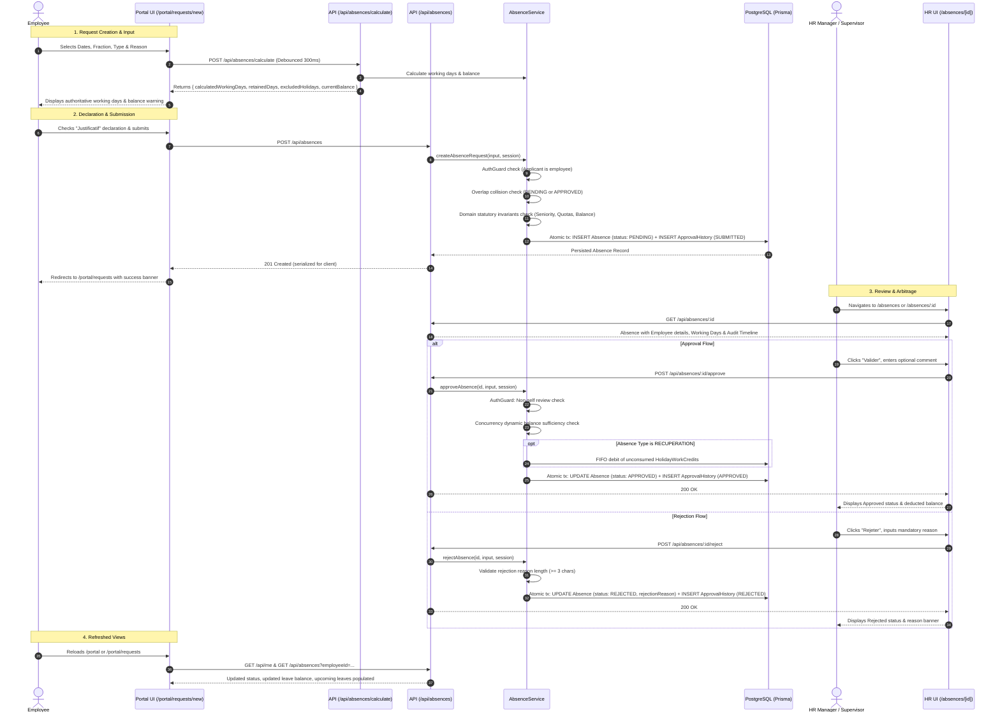

# Architecture Review & Implementation Plan: Leave & Absence Request Workflow

> **Date:** October 16, 2026  
> **Target System:** Leave & Absence Management System (Morocco - Loi n° 65-99)  
> **Status:** Comprehensive Inspection & Workflow Mapping Completed — 169 Vitest Tests & Playwright E2E Passing — No Application Code Modified

---

## 1. Specification Context & Ground Truth Verification

### 1.1 Specification File Status
- A strict workspace search for `LEAVE_REQUEST_WORKFLOW_SPEC.md` confirmed that **the file does not exist on disk** in the repository or user directory.
- In accordance with senior engineering standards, **no requirements or database schemas have been invented**.
- All workflow flows, authoritative business rules, backend contracts, and permissions documented below are extracted directly from active application code, Prisma schemas, Zod validation models, domain calculators, application services, and existing automated integration test suites ([`tests/integration/approval-workflow.test.ts`](file:///c:/Users/DailWorkStation/Desktop/absnace/tests/integration/approval-workflow.test.ts) and [`tests/e2e/absence-workflow.spec.ts`](file:///c:/Users/DailWorkStation/Desktop/absnace/tests/e2e/absence-workflow.spec.ts)).

### 1.2 Core Architectural Principle: Backend as the Single Source of Truth
- **Strict Separation of Concerns:** All business calculations (statutory working days, weekly rest day exclusions, public holiday omissions, seniority accrual, dynamic balance checks, quota caps, and credit debits) are authoritative **only in the backend** (`src/domain/` and `src/application/services/`).
- **No Client Calculations:** The frontend **never** defines, simulates, or re-calculates statutory rules or working day counts. Instead, the frontend consumes backend-calculated data via pre-flight preview (`POST /api/absences/calculate`) or persisted absence entities (`GET /api/absences`).

---

## 2. End-to-End Core Workflow Mapping

### 2.1 The Standard Flow: Employee Creates Request → Pending State → HR Review → Final Status



---

## 3. Systematic Breakdown of Supported Flows

### Flow 1: Employee Absence-Request Creation & Submission
- **User Role & Permissions:** `EMPLOYEE`, `SUPERVISOR`, `HR_MANAGER`, or `ADMIN` submitting for themselves. Enforced by [`AuthGuard.requireAccessEmployee(session, input.employeeId)`](file:///c:/Users/DailWorkStation/Desktop/absnace/src/modules/auth/auth.guard.ts#L80).
- **Existing Routes & Components:**
  - Route: [`/portal/requests/new`](file:///c:/Users/DailWorkStation/Desktop/absnace/src/app/portal/requests/new/page.tsx) or Modal on [`/portal/requests`](file:///c:/Users/DailWorkStation/Desktop/absnace/src/app/portal/requests/page.tsx).
  - Form: [`PortalLeaveRequestForm.tsx`](file:///c:/Users/DailWorkStation/Desktop/absnace/src/components/portal/PortalLeaveRequestForm.tsx).
- **Backend/API Operation:**
  - Pre-flight Preview: `POST /api/absences/calculate` $\rightarrow$ [`WorkingDaysService.calculateWorkingDays`](file:///c:/Users/DailWorkStation/Desktop/absnace/src/application/services/working-days.service.ts#L12) + [`LeaveBalanceService.getDynamicBalance`](file:///c:/Users/DailWorkStation/Desktop/absnace/src/application/services/leave-balance.service.ts#L10).
  - Submission: `POST /api/absences` $\rightarrow$ [`AbsenceService.createAbsenceRequest`](file:///c:/Users/DailWorkStation/Desktop/absnace/src/modules/absences/absence.service.ts#L22) or Server Action [`createAbsenceAction`](file:///c:/Users/DailWorkStation/Desktop/absnace/src/modules/absences/absence.actions.ts#L17).
- **Expected State Transition:** `None` $\rightarrow$ `PENDING`.
- **Audit Trail:** Creates initial entry in `ApprovalHistory` (`action: 'SUBMITTED'`, `fromStatus: 'PENDING'`, `toStatus: 'PENDING'`).
- **Error Behavior:**
  - *Validation (400):* `endDate < startDate`, non-same-day half-day, missing required reason for exceptional permissions.
  - *Domain Errors (400):* `OverlappingAbsenceError` (dates clash with existing pending/approved absence), `SeniorityThresholdNotMetError` (< 6 months seniority for annual leave), `ExceptionalPermissionQuotaExceededError`, `InsufficientLeaveBalanceError`, `RecoveryCreditDepletedError`.
  - *Permissions (403):* Employee ID does not match session user.
  - *Server Error (500):* Database connection failure or unhandled exception.
- **Screens & Queries That Must Refresh Afterward:**
  - Employee Portal: [`/portal`](file:///c:/Users/DailWorkStation/Desktop/absnace/src/app/portal/page.tsx) (`GET /api/me`, recent requests), [`/portal/requests`](file:///c:/Users/DailWorkStation/Desktop/absnace/src/app/portal/requests/page.tsx) (`getMyRequests`).
  - HR Dashboard: [`/`](file:///c:/Users/DailWorkStation/Desktop/absnace/src/app/page.tsx) ([`DashboardActionRequired`](file:///c:/Users/DailWorkStation/Desktop/absnace/src/components/dashboard/DashboardActionRequired.tsx) increments total pending, displays new item).
  - HR Directory: [`/absences`](file:///c:/Users/DailWorkStation/Desktop/absnace/src/app/absences/page.tsx) (`listAbsences` table and pending KPI count).
  - Monthly Calendar: [`/calendar`](file:///c:/Users/DailWorkStation/Desktop/absnace/src/app/calendar/page.tsx) (overlays pending absence block).

---

### Flow 2: HR Creating a Request for an Employee
- **User Role & Permissions:** `HR_MANAGER` or `ADMIN` (for any employee), or `SUPERVISOR` (for subordinates in `session.managedEmployeeIds`). Enforced by [`AuthGuard.requireAccessEmployee(session, input.employeeId)`](file:///c:/Users/DailWorkStation/Desktop/absnace/src/modules/auth/auth.guard.ts#L80).
- **Existing Routes & Components:**
  - Route: [`/absences`](file:///c:/Users/DailWorkStation/Desktop/absnace/src/app/absences/page.tsx) (via "Nouvelle Demande" button in `PageHeader`).
  - Form: [`AbsenceModalForm.tsx`](file:///c:/Users/DailWorkStation/Desktop/absnace/src/components/absences/AbsenceModalForm.tsx) with `mode="create"`.
- **Backend/API Operation:** `POST /api/absences` with payload containing arbitrary permitted `employeeId`.
- **Expected State Transition:** `None` $\rightarrow$ `PENDING`.
- **Audit Trail:** Recorded with `performedByUserId: session.userId` (the HR/Admin user) and `performedByEmployeeId: session.employeeId`.
- **Error Behavior:**
  - If a supervisor attempts to submit for an employee not in their reporting tree, [`AuthGuard.canAccessEmployee`](file:///c:/Users/DailWorkStation/Desktop/absnace/src/modules/auth/auth.guard.ts#L62) throws `ForbiddenError` (403).
  - Full statutory invariants (seniority, quotas, balance, overlap) remain strictly enforced.
- **Screens & Queries That Must Refresh Afterward:**
  - HR Directory: [`/absences`](file:///c:/Users/DailWorkStation/Desktop/absnace/src/app/absences/page.tsx) table and KPI badges.
  - HR Dashboard: [`/`](file:///c:/Users/DailWorkStation/Desktop/absnace/src/app/page.tsx) pending action list.
  - Employee Portal: Target employee's [`/portal`](file:///c:/Users/DailWorkStation/Desktop/absnace/src/app/portal/page.tsx) and [`/portal/requests`](file:///c:/Users/DailWorkStation/Desktop/absnace/src/app/portal/requests/page.tsx).

---

### Flow 3: Editing / Modifying a Pending Request
- **User Role & Permissions:**
  - `EMPLOYEE`: Can edit their own `PENDING` request.
  - `SUPERVISOR`: Can edit `PENDING` requests of managed subordinates.
  - `HR_MANAGER` / `ADMIN`: Can edit any `PENDING` request.
  - Enforced by: [`AuthGuard.requireAccessEmployee(session, existing.employeeId)`](file:///c:/Users/DailWorkStation/Desktop/absnace/src/modules/absences/absence.service.ts#L407) and state check `existing.status === 'PENDING'`.
- **Existing Routes & Components:**
  - HR Directory: [`/absences`](file:///c:/Users/DailWorkStation/Desktop/absnace/src/app/absences/page.tsx) (via edit icon on PENDING row).
  - HR Detail Page: [`/absences/[id]`](file:///c:/Users/DailWorkStation/Desktop/absnace/src/app/absences/[id]/page.tsx) (via "Modifier" button).
  - Form: [`AbsenceModalForm.tsx`](file:///c:/Users/DailWorkStation/Desktop/absnace/src/components/absences/AbsenceModalForm.tsx) with `mode="edit"`.
  - *Portal Note:* Backend supports employee editing, but the employee portal currently lacks an edit trigger button in [`PortalRequestDetailsModal.tsx`](file:///c:/Users/DailWorkStation/Desktop/absnace/src/components/portal/PortalRequestDetailsModal.tsx).
- **Backend/API Operation:** `PUT /api/absences/:id` $\rightarrow$ [`AbsenceService.updateAbsenceRequest`](file:///c:/Users/DailWorkStation/Desktop/absnace/src/modules/absences/absence.service.ts#L396).
- **Expected State Transition:** `PENDING` $\rightarrow$ `PENDING` (Fields updated: dates, fraction, type, reason, working days, comment).
- **Audit Trail:** Appends `ApprovalHistory` record with `action: 'CORRECTED'`, `fromStatus: 'PENDING'`, `toStatus: 'PENDING'`, `comment: 'Demande d\'absence modifiée.'`.
- **Error Behavior:**
  - Status not `PENDING`: Throws `400 Bad Request` (`"Seules les demandes en attente (PENDING) peuvent être modifiées."`).
  - Overlap check: Excludes current `absenceId` from collision query, but rejects if newly selected dates collide with another absence.
- **Screens & Queries That Must Refresh Afterward:**
  - [`/absences/[id]`](file:///c:/Users/DailWorkStation/Desktop/absnace/src/app/absences/[id]/page.tsx) (re-fetches updated working days, dates, and audit timeline).
  - [`/absences`](file:///c:/Users/DailWorkStation/Desktop/absnace/src/app/absences/page.tsx) (row data updates).
  - Target employee portal views.

---

### Flow 4: Cancelling an Absence Request
- **User Role & Permissions:**
  - `EMPLOYEE`: Can cancel their own request if status is `PENDING` OR if status is `APPROVED` and `startDate > today` (future leave).
  - `HR_MANAGER` / `ADMIN`: Can cancel `PENDING` or `APPROVED` requests at any time (even if already started).
  - Closed requests (`REJECTED`, `CANCELLED`) cannot be cancelled by anyone.
  - Enforced by: [`AbsenceService.cancelAbsence`](file:///c:/Users/DailWorkStation/Desktop/absnace/src/modules/absences/absence.service.ts#L343-L370).
- **Existing Routes & Components:**
  - HR Screens: [`CancelAbsenceDialog`](file:///c:/Users/DailWorkStation/Desktop/absnace/src/components/absences/AbsenceWorkflowDialogs.tsx#L250) on [`/absences`](file:///c:/Users/DailWorkStation/Desktop/absnace/src/app/absences/page.tsx) and [`/absences/[id]`](file:///c:/Users/DailWorkStation/Desktop/absnace/src/app/absences/[id]/page.tsx).
  - Employee Portal: [`PortalRequestDetailsModal.tsx`](file:///c:/Users/DailWorkStation/Desktop/absnace/src/components/portal/PortalRequestDetailsModal.tsx#L200) inline cancellation prompt.
- **Backend/API Operation:** `POST /api/absences/:id/cancel` with optional `{ reason: string }` $\rightarrow$ [`AbsenceService.cancelAbsence`](file:///c:/Users/DailWorkStation/Desktop/absnace/src/modules/absences/absence.service.ts#L343).
- **Expected State Transition:** `PENDING` $\rightarrow$ `CANCELLED` or `APPROVED` $\rightarrow$ `CANCELLED`.
- **Audit Trail:** Appends `ApprovalHistory` record with `action: 'CANCELLED'`, `fromStatus: previousStatus`, `toStatus: 'CANCELLED'`, `comment: reason ?? 'Absence cancelled.'`.
- **Error Behavior:**
  - Already closed: Throws `400 Bad Request` (`"Absence is already closed with status..."`).
  - Employee cancelling active/past approved leave: Throws `403 Forbidden` (`"Approved leaves that have already started require HR intervention to cancel."`).
- **Screens & Queries That Must Refresh Afterward:**
  - If approved leave was cancelled, leave balance is restored:
    - [`/leave-balances`](file:///c:/Users/DailWorkStation/Desktop/absnace/src/app/leave-balances/page.tsx) & [`/portal`](file:///c:/Users/DailWorkStation/Desktop/absnace/src/app/portal/page.tsx) balance cards.
  - Directory & Detail pages update status badge to `CANCELLED`.
  - [`DashboardActionRequired`](file:///c:/Users/DailWorkStation/Desktop/absnace/src/components/dashboard/DashboardActionRequired.tsx) decrements if it was pending.
  - [`/calendar`](file:///c:/Users/DailWorkStation/Desktop/absnace/src/app/calendar/page.tsx) removes absence overlay.

---

### Flow 5: HR Review (Approval or Rejection)
- **User Role & Permissions:**
  - `HR_MANAGER` / `ADMIN`: Can review all absence requests across the organization.
  - `SUPERVISOR`: Can review requests submitted by subordinates in their reporting line (`session.managedEmployeeIds`).
  - `EMPLOYEE`: Cannot review any requests (403 Forbidden).
  - **Universal Invariant:** Self-approval is strictly forbidden across all roles ([`AuthGuard.requireCanReviewAbsence`](file:///c:/Users/DailWorkStation/Desktop/absnace/src/modules/auth/auth.guard.ts#L118)).
- **Existing Routes & Components:**
  - Directory: Quick action buttons on [`/absences`](file:///c:/Users/DailWorkStation/Desktop/absnace/src/app/absences/page.tsx).
  - Detail Page: Dedicated action buttons on [`/absences/[id]`](file:///c:/Users/DailWorkStation/Desktop/absnace/src/app/absences/[id]/page.tsx).
  - Dialogs: [`ApproveAbsenceDialog`](file:///c:/Users/DailWorkStation/Desktop/absnace/src/components/absences/AbsenceWorkflowDialogs.tsx#L26) and [`RejectAbsenceDialog`](file:///c:/Users/DailWorkStation/Desktop/absnace/src/components/absences/AbsenceWorkflowDialogs.tsx#L134).
- **Backend/API Operation:**
  - Approval: `POST /api/absences/:id/approve` with optional `{ comment: string }`.
  - Rejection: `POST /api/absences/:id/reject` with mandatory `{ reason: string }` (min 3 chars).
- **Expected State Transition:**
  - Approval: `PENDING` $\rightarrow$ `APPROVED`. Populates `approvedById: session.userId` and `approvedAt: new Date()`.
  - Rejection: `PENDING` $\rightarrow$ `REJECTED`. Populates `rejectionReason: reason`, `approvedById: session.userId`, `approvedAt: new Date()`.
- **Audit Trail:**
  - Approval: `action: 'APPROVED'`, `fromStatus: 'PENDING'`, `toStatus: 'APPROVED'`.
  - Rejection: `action: 'REJECTED'`, `fromStatus: 'PENDING'`, `toStatus: 'REJECTED'`.
- **Special Backend Logic for Recovery Leaves:**
  - If type is `RECUPERATION`, [`RecoveryCreditService.consumeCredits`](file:///c:/Users/DailWorkStation/Desktop/absnace/src/application/services/recovery-credit.service.ts#L61) debits unconsumed `HolidayWorkCredit` records in FIFO chronological order within the transaction.
- **Error Behavior:**
  - Self-Approval attempt: 403 Forbidden (`"Self-approval violation: An approver cannot approve or reject their own leave request."`).
  - Rejection without reason: 400 Bad Request (`"Rejection justification is mandatory."`).
  - Non-pending status: 400 Bad Request (`"Cannot approve absence with status..."`).
  - Concurrency balance conflict: 400 Bad Request (`"Concurrency conflict: Remaining balance is now insufficient..."`).
- **Screens & Queries That Must Refresh Afterward:**
  - `/absences/[id]`: Status updates, audit timeline appends new event, balance card reflects new balance.
  - `/absences`: Row updates, KPI metrics update.
  - `/`: Pending count decrements, item removed from pending cards.
  - `/leave-balances`: Live balance decrements by `retainedDays`.
  - Employee Portal (`/portal` and `/portal/requests`): Status updates, upcoming approved leaves list updates.

---

### Flow 6: Viewing Backend-Calculated Working Days & Retained Days
- **User Role & Permissions:**
  - Authenticated user viewing their own or permitted employee's calculation.
- **Existing Routes & Components:**
  - Pre-flight Preview: [`PortalLeaveRequestForm.tsx`](file:///c:/Users/DailWorkStation/Desktop/absnace/src/components/portal/PortalLeaveRequestForm.tsx#L420) and [`AbsenceModalForm.tsx`](file:///c:/Users/DailWorkStation/Desktop/absnace/src/components/absences/AbsenceModalForm.tsx#L380) render the calculation card:
    - `enteredDays`: Total calendar span.
    - `calculatedWorkingDays`: Net statutory working days.
    - `excludedHolidaysCount`: Fériés exclus.
    - `excludedWeeklyRestDaysCount`: Repos hebdomadaires exclus.
    - `currentBalance.netAvailableBalance`: Current available balance.
  - Detail View: [`/absences/[id]`](file:///c:/Users/DailWorkStation/Desktop/absnace/src/app/absences/[id]/page.tsx#L320) renders "Décompte légal des jours (Moteur statutaire)".
  - Table Views: [`/absences`](file:///c:/Users/DailWorkStation/Desktop/absnace/src/app/absences/page.tsx) and [`/portal/requests`](file:///c:/Users/DailWorkStation/Desktop/absnace/src/app/portal/requests/page.tsx) display `{retainedDays} jour(s) ouvré(s) ({enteredDays} j. cal.)`.
- **Backend/API Operation:**
  - Live calculation: `POST /api/absences/calculate` $\rightarrow$ [`WorkingDaysService.calculateWorkingDays`](file:///c:/Users/DailWorkStation/Desktop/absnace/src/application/services/working-days.service.ts#L12).
  - Persisted record query: `GET /api/absences/:id` $\rightarrow$ [`AbsenceService.getAbsenceById`](file:///c:/Users/DailWorkStation/Desktop/absnace/src/modules/absences/absence.service.ts#L135).
- **Authoritative Rule Enforcement:**
  - Frontend strictly displays values returned from the backend response. No manual JavaScript date subtraction (`end - start`) is performed in UI code to determine working days.

---

## 4. Unsupported Workflows & Missing Backend Capabilities

The prompt mandates: *"Account for other capabilities only if the existing backend supports them... Identify any unsupported workflow instead of assuming it should be added."*

The following capabilities are **UNSUPPORTED** by the existing backend and must NOT be added without explicit backend schema and service changes:

```
+-------------------------------------------------------------------------------------------------------+
|                                  UNSUPPORTED BACKEND CAPABILITIES                                     |
+------------------------------------+------------------------------------------------------------------+
| Capability                         | Backend Reality & Limitation                                     |
+------------------------------------+------------------------------------------------------------------+
| Replacing an attached document     | UNSUPPORTED. The Prisma schema has NO file entity, document URL,  |
|                                    | or storage path on `Absence`. It only contains a boolean column  |
|                                    | `supportingDocumentProvided: Boolean`. No file replace API exists|
+------------------------------------+------------------------------------------------------------------+
| Physical file upload / storage     | UNSUPPORTED. While `FormFileUpload.tsx` exists in UI components, |
|                                    | there is NO multipart upload handler or storage bucket configured|
+------------------------------------+------------------------------------------------------------------+
| Multi-level sequential approval    | UNSUPPORTED. There is no 2-stage approval (e.g. Supervisor THEN  |
| (Supervisor -> HR Manager)         | HR). A single approval by either reviewer transitions directly   |
|                                    | from `PENDING` to `APPROVED`.                                    |
+------------------------------------+------------------------------------------------------------------+
| Editing an APPROVED absence        | UNSUPPORTED. `AbsenceService.updateAbsenceRequest` strictly      |
|                                    | requires `status === 'PENDING'`. Approved requests cannot be     |
|                                    | edited; they must be cancelled and re-submitted.                 |
+------------------------------------+------------------------------------------------------------------+
| Employee self-cancelling started   | UNSUPPORTED. If `startDate <= today` on an approved leave,       |
| approved leave                     | backend strictly throws 403 unless role is `HR_MANAGER` or `ADMIN|
+------------------------------------+------------------------------------------------------------------+
| Overdraft / Negative leave balance | UNSUPPORTED. The backend strictly rejects approval if            |
| ("Congé par anticipation")         | `netAvailableBalance < requiredDays`. No override exists.        |
+------------------------------------+------------------------------------------------------------------+
| Automated email / push alerts      | UNSUPPORTED. No notification table, SMTP client, or mail queue   |
|                                    | exists. State transitions are purely recorded in database audit. |
+------------------------------------+------------------------------------------------------------------+
```

---

## 5. Flow-by-Flow Specification & Refresh Matrix

| Flow | Initiator Role | Route / Component | API Operation | From Status $\rightarrow$ To Status | Success Response | Error Codes | Screens / Queries to Refresh |
| :--- | :--- | :--- | :--- | :--- | :--- | :--- | :--- |
| **1. Create Request (Self)** | `EMPLOYEE` | `/portal/requests/new`<br>`PortalLeaveRequestForm` | `POST /api/absences` | `None` $\rightarrow$ `PENDING` | `201 Created`<br>`AbsenceListItem` | 400 (Bad input/Domain)<br>401 (Unauth)<br>403 (Mismatch) | `/portal/requests`<br>`/portal` (`/api/me`)<br>`/` (Dashboard Actions)<br>`/absences`<br>`/calendar` |
| **2. Create Request (HR for Emp)**| `HR_MANAGER`<br>`ADMIN`<br>`SUPERVISOR` | `/absences`<br>`AbsenceModalForm` | `POST /api/absences` | `None` $\rightarrow$ `PENDING` | `201 Created`<br>`AbsenceListItem` | 400 (Bad input/Domain)<br>403 (Not subordinate)<br>401 (Unauth) | `/absences`<br>`/` (Dashboard Actions)<br>Target employee portal |
| **3. Edit Pending Request** | `EMPLOYEE`<br>`SUPERVISOR`<br>`HR_MANAGER` | `/absences/[id]`<br>`/absences`<br>`AbsenceModalForm` | `PUT /api/absences/:id` | `PENDING` $\rightarrow$ `PENDING` | `200 OK`<br>`AbsenceListItem` | 400 (Not PENDING/Collision)<br>403 (Forbidden)<br>404 (Not found) | `/absences/[id]`<br>`/absences`<br>`/calendar`<br>Employee portal |
| **4. Cancel Absence** | `EMPLOYEE` (pending/future)<br>`HR_MANAGER` (all) | `/absences/[id]`<br>`CancelAbsenceDialog`<br>`PortalRequestDetailsModal` | `POST /api/absences/:id/cancel` | `PENDING` or `APPROVED` $\rightarrow$ `CANCELLED` | `200 OK`<br>`AbsenceListItem` | 400 (Already closed)<br>403 (Started approved / unauth) | `/absences/[id]`<br>`/absences`<br>`/leave-balances`<br>`/` (Dashboard Actions)<br>`/portal/requests` |
| **5. Approve Absence** | `SUPERVISOR` (team)<br>`HR_MANAGER` (all) | `/absences/[id]`<br>`ApproveAbsenceDialog` | `POST /api/absences/:id/approve` | `PENDING` $\rightarrow$ `APPROVED` | `200 OK`<br>`AbsenceListItem` | 400 (Not PENDING/Balance race)<br>403 (Self-approval/unauth) | `/absences/[id]`<br>`/absences`<br>`/leave-balances`<br>`/` (Dashboard Actions)<br>`/calendar`<br>`/portal` |
| **6. Reject Absence** | `SUPERVISOR` (team)<br>`HR_MANAGER` (all) | `/absences/[id]`<br>`RejectAbsenceDialog` | `POST /api/absences/:id/reject` | `PENDING` $\rightarrow$ `REJECTED` | `200 OK`<br>`AbsenceListItem` | 400 (Missing reason < 3 chars)<br>403 (Self-approval/unauth) | `/absences/[id]`<br>`/absences`<br>`/` (Dashboard Actions)<br>`/portal/requests` |
| **7. Pre-flight Calculation** | Any authenticated user | `PortalLeaveRequestForm`<br>`AbsenceModalForm` | `POST /api/absences/calculate` | No State Change | `200 OK`<br>`CalculationPreviewResult` | 400 (Invalid dates/Missing)<br>404 (Emp not found) | Live preview UI card only |

---

## 6. Implementation Checklist & Acceptance Criteria

### Milestone 1: API Security & Cache Revalidation
- [ ] **AC 1.1 (Security):** `POST /api/absences/calculate` requires authentication via `SessionResolver.require()` and enforces `AuthGuard.requireAccessEmployee(session, employeeId)`. Unauthenticated requests return 401; attempts to inspect other employees' balances return 403.
- [ ] **AC 1.2 (Cache Revalidation):** `src/modules/absences/absence.actions.ts` invokes `revalidatePath('/absences')`, `revalidatePath('/portal/requests')`, and `revalidatePath('/')` on all mutations (`create`, `approve`, `reject`, `cancel`, `update`).

### Milestone 2: Employee Portal Alignment
- [ ] **AC 2.1 (Future Approved Cancellation):** `PortalRequestDetailsModal.tsx` enables the cancellation action when `absence.status === 'APPROVED'` and `new Date(absence.startDate) > new Date()`, matching `AbsenceService.cancelAbsence`.
- [ ] **AC 2.2 (Local Date Initialization):** `PortalLeaveRequestForm.tsx` initializes dates using Moroccan local time (`Africa/Casablanca`, UTC+1) instead of UTC `.toISOString()`.
- [ ] **AC 2.3 (Portal Pending Edit Trigger):** If permitted by UX requirements, expose an "Éditer" button for `PENDING` requests in `PortalRequestDetailsModal.tsx` that reuses the existing `PortalLeaveRequestForm` in edit mode.

### Milestone 3: HR Directory & Workflow Interactions
- [ ] **AC 3.1 (Supervisor Scoping):** When accessed by a `SUPERVISOR`, the employee filter dropdown on `/absences` only lists supervised employees matching `session.managedEmployeeIds`.
- [ ] **AC 3.2 (Action Confirmation & Feedback):** Quick actions on `/absences` (Valider, Rejeter, Annuler) trigger immediate optimistic/confirmed state update and refresh the KPI cards without full page reload.
- [ ] **AC 3.3 (Audit Trail Presentation):** In `/absences/[id]`, verify that `ApprovalHistory` displays the correct chronological timeline with actor email, role, and comment.

### Milestone 4: Verification & Regression Tests
- [ ] **AC 4.1 (Unit & Integration Suite):** All 169 existing tests pass without regressions.
- [ ] **AC 4.2 (End-to-End Test Suite):** Playwright tests in `tests/e2e/absence-workflow.spec.ts` verify the complete lifecycle: Employee draft $\rightarrow$ Calculation preview $\rightarrow$ Submission $\rightarrow$ HR rejection with reason $\rightarrow$ Modification $\rightarrow$ HR approval $\rightarrow$ Balance deduction $\rightarrow$ Audit trail.

---

## 7. Summary of Relevant File Links

- **Application Absence Service:** [`src/modules/absences/absence.service.ts`](file:///c:/Users/DailWorkStation/Desktop/absnace/src/modules/absences/absence.service.ts)
- **Validation Schemas:** [`src/modules/absences/absence.schema.ts`](file:///c:/Users/DailWorkStation/Desktop/absnace/src/modules/absences/absence.schema.ts)
- **Server Actions:** [`src/modules/absences/absence.actions.ts`](file:///c:/Users/DailWorkStation/Desktop/absnace/src/modules/absences/absence.actions.ts)
- **Security & RBAC Guards:** [`src/modules/auth/auth.guard.ts`](file:///c:/Users/DailWorkStation/Desktop/absnace/src/modules/auth/auth.guard.ts)
- **Domain Legal Invariants:** [`src/domain/validation/leave-validation.rules.ts`](file:///c:/Users/DailWorkStation/Desktop/absnace/src/domain/validation/leave-validation.rules.ts)
- **Working Days Calculator:** [`src/domain/calculations/working-days.calculator.ts`](file:///c:/Users/DailWorkStation/Desktop/absnace/src/domain/calculations/working-days.calculator.ts)
- **Recovery Credit Service:** [`src/application/services/recovery-credit.service.ts`](file:///c:/Users/DailWorkStation/Desktop/absnace/src/application/services/recovery-credit.service.ts)
- **Employee Portal Requests:** [`src/app/portal/requests/page.tsx`](file:///c:/Users/DailWorkStation/Desktop/absnace/src/app/portal/requests/page.tsx)
- **HR Absences Directory:** [`src/app/absences/page.tsx`](file:///c:/Users/DailWorkStation/Desktop/absnace/src/app/absences/page.tsx)
- **HR Absence Detail Page:** [`src/app/absences/[id]/page.tsx`](file:///c:/Users/DailWorkStation/Desktop/absnace/src/app/absences/%5Bid%5D/page.tsx)
- **Integration Tests:** [`tests/integration/approval-workflow.test.ts`](file:///c:/Users/DailWorkStation/Desktop/absnace/tests/integration/approval-workflow.test.ts)
- **E2E Playwright Suite:** [`tests/e2e/absence-workflow.spec.ts`](file:///c:/Users/DailWorkStation/Desktop/absnace/tests/e2e/absence-workflow.spec.ts)
